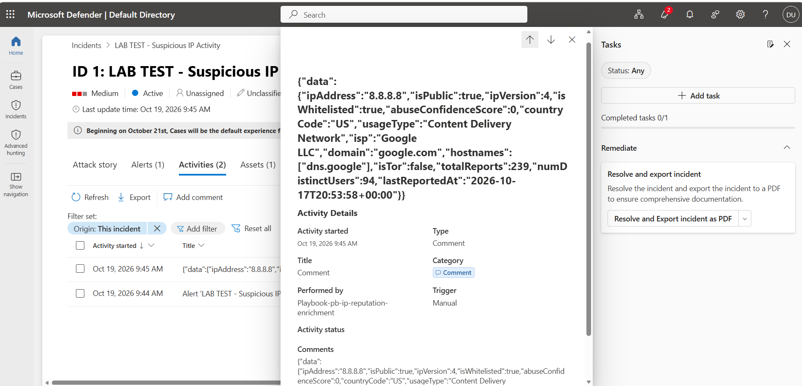
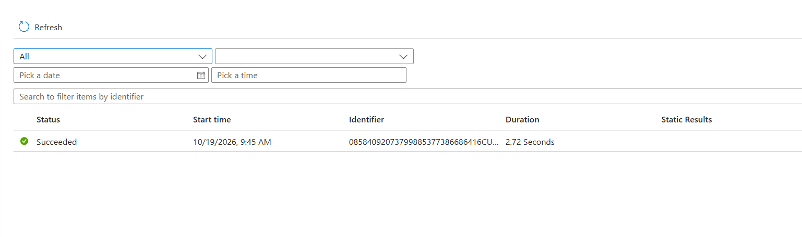
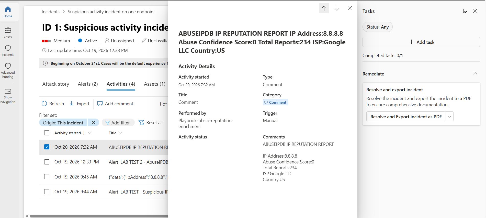
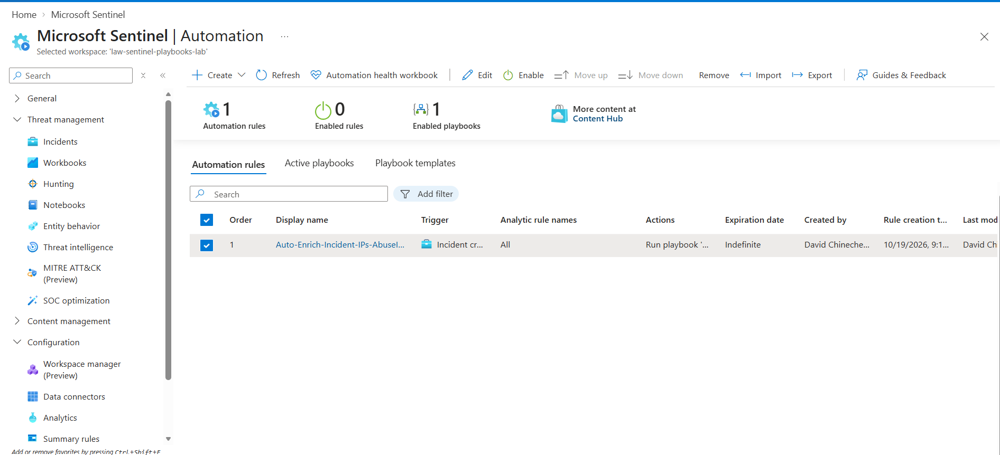

# Microsoft Sentinel SOAR — Automated AbuseIPDB IP Enrichment

A hands-on cloud security automation lab using **Microsoft Sentinel**, **Azure Logic Apps**, and the **AbuseIPDB API** to enrich IP entities in security incidents and post reputation context directly to incident activities.

> **Portfolio project 3** | Environment: Microsoft Azure (East US) | Test data: deliberately simulated security alerts, not real attacks

## Project overview

During triage, a SOC analyst often needs to check suspicious IP addresses against external threat-intelligence sources. This project automates that repetitive lookup. A Sentinel incident supplies its IP entities; a Logic Apps playbook queries AbuseIPDB for each IP and posts the response as an incident comment.

**Objective:** Reduce manual lookups while keeping an analyst responsible for interpreting reputation data. Abuse reports by themselves do not prove malicious behavior.

## Architecture

```text
Simulated security alert
         |
         v
Microsoft Sentinel incident
         |
         +-- Automation rule: incident created --> Run playbook
         |
         v
Azure Logic Apps: pb-ip-reputation-enrichment
         |
         v
Microsoft Sentinel incident trigger
         |
         v
Entities - Get IPs
         |
         v
For each IP address
    |
    +--> HTTP GET https://api.abuseipdb.com/api/v2/check
    |       query: ipAddress=<incident IP>, maxAgeInDays=90
    |       headers: Accept=application/json, Key=<SECRET>
    |
    +--> Add comment to incident (V3)
                |
                v
        Sentinel incident activity
```

See [architecture and component roles](architecture/README.md) and [playbook workflow](docs/workflow.md).

## Technology stack

| Component | Purpose |
| --- | --- |
| Microsoft Sentinel | Incidents, analytics/automation integration, IP entities |
| Azure Logic Apps (Consumption) | SOAR playbook with Sentinel incident trigger |
| Microsoft Sentinel connector | Extract incident IP entities and add comments |
| AbuseIPDB API v2 | IP reputation information |
| Azure Log Analytics workspace | Backing workspace for Sentinel |
| Azure managed identity + RBAC | Authorize the playbook to update incidents |

## What was implemented

1. Created Azure resource group `rg-sentinel-playbooks-lab` and Log Analytics workspace `law-sentinel-playbooks-lab`.
2. Enabled Microsoft Sentinel and created the incident-triggered Logic App `pb-ip-reputation-enrichment`.
3. Added **Entities – Get IPs**, an automatically generated **For each** loop, an HTTP `GET` call to AbuseIPDB, and **Add comment to incident (V3)**.
4. Granted the Logic App managed identity **Microsoft Sentinel Contributor** scoped to the lab resource group. Configured Sentinel playbook execution permissions for the same group.
5. Created the automation rule `Auto-Enrich-Incident-IPs-AbuseIPDB` for **When incident is created**.
6. Tested with a clearly labelled simulated alert and public Google DNS IP `8.8.8.8`. Confirmed an **automated** playbook run posted AbuseIPDB JSON to the incident.
7. Reformatted the incident comment with dynamic expressions and manually reran the playbook against the same incident. Confirmed **Succeeded** status and a readable IP reputation comment.
8. Disabled the automation rule after validation to reduce unintended executions. The Logic App itself remained enabled at the time of the final screenshot.

## Verified test results

| Test | Observed result |
| --- | --- |
| First simulated alert | Created/linked to Sentinel Incident 1 |
| Automation on incident creation | Ran successfully and posted AbuseIPDB JSON to Incident 1 |
| First Logic App execution | **Succeeded**, approximately **2.72 seconds** |
| Updated formatted comment | Manually invoked against Incident 1; run **Succeeded** |
| Final formatted fields | IP, abuse confidence score, total reports, ISP, country |
| Second test alert | Correlated with existing Incident 1, so **did not** cause a fresh incident-created trigger |

In the final documented test, AbuseIPDB returned **0% abuse confidence**, **234 total reports**, **Google LLC** as ISP, and **US** as country for `8.8.8.8`. Counts are point-in-time results and may change. This IP was chosen for functionality testing, **not** as a malicious indicator.

### Evidence screenshots

Screenshots are captured locally and will be uploaded to the `screenshots/` folder. After upload, use the links below:

| Evidence | Filename |
| --- | --- |
| Original automated incident comment containing AbuseIPDB JSON | [01-abuseipdb-incident-comment.png](screenshots/01-abuseipdb-incident-comment.png) |
| Successful Logic App run history | [02-playbook-successful-run.png](screenshots/02-playbook-successful-run.png) |
| Readable AbuseIPDB incident report after manual rerun | [03-formatted-abuseipdb-report.png](screenshots/03-formatted-abuseipdb-report.png) |
| Automation rule disabled following testing | [04-automation-rule-disabled.png](screenshots/04-automation-rule-disabled.png) |

### Screenshots — observed lab evidence

**1. Automated incident enrichment (original JSON response)**



**2. Successful Azure Logic Apps run**



**3. SOC-friendly formatted IP reputation comment (manual rerun)**



**4. Automation rule disabled after validation**



## Security notes

- **No API credentials are committed to this repository.** The AbuseIPDB `Key` header is a secret and should not appear in screenshots, exported Logic App definitions, or source control.
- The HTTP action was configured with **Secure Inputs** and **Secure Outputs** to limit sensitive data exposure in run history. **This does not encrypt or remove secrets from the workflow definition**; for production, store API keys in **Azure Key Vault** and retrieve them securely.
- Lab permissions were scoped to the project resource group. Production deployments should favor more tightly restricted custom roles where feasible.
- The automated rule was intentionally disabled after testing. Disabling an automation rule alone does **not** delete underlying Azure resources or prevent all Azure charges.
- This lab did **not** deploy live public honeypots or expose RDP. It used controlled simulated Sentinel alerts.

## Documentation

- [Architecture](architecture/README.md)
- [Playbook logic and expressions](docs/workflow.md)
- [Validation and troubleshooting](docs/validation.md)
- [Security and cleanup](docs/security-and-cleanup.md)
- [Evidence checklist](screenshots/README.md)

## Skills demonstrated

Microsoft Sentinel · SOAR automation · Logic Apps · Incident and entity handling · REST APIs and JSON · Managed identities and RBAC · Alert testing · SOC enrichment workflows

---

**Lab scope:** This repository documents the playbook and verified incident response. It does not claim implementation of the mentor's separate Linux honeypot, Windows RDP server, or geolocation workbooks.
